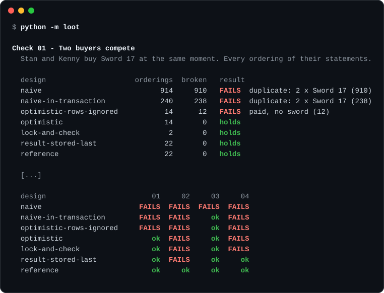
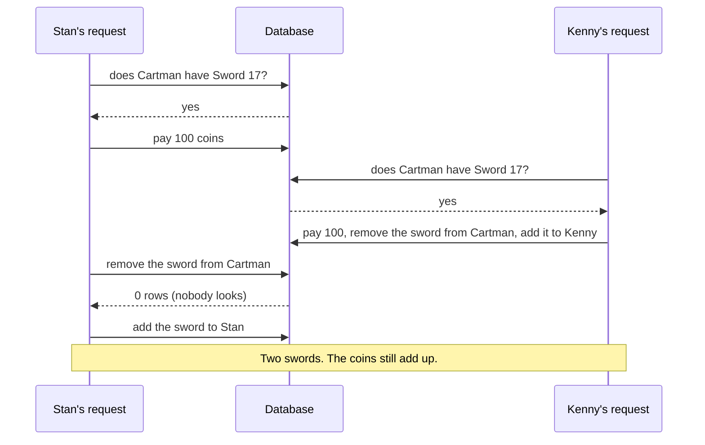

<div align="center">

<h1>Bank-Grade Loot</h1>

<p>
  <b>Two players press Buy on the same sword. Both get it.</b><br>
  Small, runnable models of how game backends duplicate items and money,<br>
  checked in every possible ordering to show which fixes hold.
</p>

<p>
  
  
  <a href="LICENSE"></a>
</p>



</div>

Companion code for the talk **Bank-Grade Loot: Preventing Dupes in Game Backends** (Game Industry Conference 2026).

A *dupe* is a bug that lets players copy an item or a currency. The talk follows one sword and one paid purchase
through a series of failures. This repository lets you watch each failure happen, and then check that the fix holds:
not in one lucky run, but in every ordering of the statements, with the process stopping at every point.

## Quick start

No dependencies. Python 3.10 or newer.

```bash
git clone https://github.com/Butterski/bank-grade-loot.git
cd bank-grade-loot
python -m loot
```

| Command | What you get |
|---|---|
| `python -m loot` | The six checks against every design |
| `python -m loot show 01 naive` | One broken ordering, statement by statement |
| `python -m loot saves` | A server that keeps the world in memory, and stops |
| `python -m loot generated` | The trade as four language models wrote it, and how they were asked |
| `python -m loot numbers` | The arithmetic, with your own values |

## What it finds

| Scenario | Result |
|---|---|
| A naive trade, two buyers | **910 of 914** orderings end with two swords |
| The same statements between `BEGIN` and `COMMIT` | still **238 of 240** |
| Lock the rows, check, then write | **0**: the lock leaves two orderings, and both are fine |
| The operation result stored at the end, the request sent twice | **20 of 22** orderings give one copy the wrong answer |
| An outbox, and a wallet that counts every message | **200 gems** for one payment |
| The full purchase flow from the talk, with up to two stops | **0 of 13,610** |
| Characters saved one at a time, and the server stops | 2 of 16 histories duplicate the sword, 2 destroy it |

## Watch a dupe happen

Cartman sells Sword 17 for 100 coins. Stan and Kenny both press Buy.



That is one of 910 broken orderings. Ask for it and you get every statement:

```text
$ python -m loot show 01 naive
Check 01 (Two buyers compete), design "naive": 910 of 914 orderings break it.

One of the 910 that end with: duplicate: 2 x Sword 17

  Stan   SELECT * FROM inventory WHERE player = 'Cartman' AND item = 17   -> 1 row
  Stan   SELECT * FROM wallets WHERE player = 'Stan'                      -> player=Stan, coins=100
  Stan   UPDATE wallets SET coins = coins - 100 WHERE player = 'Stan'     -> 1 row
  Stan   UPDATE wallets SET coins = coins + 100 WHERE player = 'Cartman'  -> 1 row
  Kenny  SELECT * FROM inventory WHERE player = 'Cartman' AND item = 17   -> 1 row
  Kenny  SELECT * FROM wallets WHERE player = 'Kenny'                     -> player=Kenny, coins=100
  Kenny  UPDATE wallets SET coins = coins - 100 WHERE player = 'Kenny'    -> 1 row
  Kenny  UPDATE wallets SET coins = coins + 100 WHERE player = 'Cartman'  -> 1 row
  Kenny  DELETE FROM inventory WHERE player = 'Cartman' AND item = 17     -> 1 row
  Kenny  INSERT INTO inventory VALUES ('Kenny', 17)                       -> 1 row
  Stan   DELETE FROM inventory WHERE player = 'Cartman' AND item = 17     -> 0 rows
  Stan   INSERT INTO inventory VALUES ('Stan', 17)                        -> 1 row

  Stan is told: ok: Stan owns Sword 17
  Kenny is told: ok: Kenny owns Sword 17
  State: Cartman: 200 coins | Stan: 0 coins, Sword 17 | Kenny: 0 coins, Sword 17
```

Note the coins: 200 before, 200 after. A check on the money alone says everything is fine.

The four orderings that survive are the ones in which one request had already removed the sword before the other one
looked. Putting the same statements between `BEGIN` and `COMMIT` leaves two: a transaction makes the trade
all-or-nothing, but it does not stop two requests from reading the same old state.

## The six checks

| | The failure | What must be true afterwards |
|---|---|---|
| 01 | Two buyers compete | One owner, one payment, the other buyer keeps his coins |
| 02 | The same request arrives twice | The stored result, no second transfer |
| 03 | The process stops before commit | No partial trade |
| 04 | The reply is lost and the client asks again | One trade, and the right answer the second time |
| 05 | A paid event arrives twice | One grant per purchase |
| 06 | A payment has no grant | It is found and delivered once |

## Seven ways to write the trade

| Design | 01<br>Two buyers | 02<br>Sent twice | 03<br>Stops early | 04<br>Reply lost | One wallet,<br>two purchases |
|---|:-:|:-:|:-:|:-:|:-:|
| `naive` | ❌ | ❌ | ❌ | ❌ | ❌ |
| `naive-in-transaction` | ❌ | ❌ | ✅ | ❌ | ❌ |
| `optimistic-rows-ignored` | ❌ | ❌ | ✅ | ❌ | ✅ |
| `optimistic` | ✅ | ❌ | ✅ | ❌ | ✅ |
| `lock-and-check` | ✅ | ❌ | ✅ | ❌ | ✅ |
| `result-stored-last` | ✅ | ❌ | ✅ | ✅ | ✅ |
| `reference` | ✅ | ✅ | ✅ | ✅ | ✅ |

- **`lock-and-check`** and **`optimistic`** protect the complete action and nothing else. They never duplicate the
  sword, but a repeated request is told "item unavailable" about a sword its sender already owns.
- **`result-stored-last`** looks the operation up first and stores its result at the end of the transaction. A retry
  that arrives later gets the stored answer. Two copies in flight both find nothing, and in 20 of 22 orderings one of
  them is refused.
- **`reference`** claims the operation ID first, with an insert that the second copy has to wait for, and gives the
  same answer to the same request in every ordering.
- **One wallet, two purchases** is not one of the six checks. Stan has 100 coins and buys two items for 100 each at
  the same moment. The designs that only *look* at the balance go below zero.

## The purchase

Stan pays EUR 9.99 for 100 gems. The game saves the purchase and a separate wallet holds the gems, so one database
transaction cannot cover both.

```text
Check 06 - A payment has no grant
  The whole purchase with stops at every point, with and without a retry from the client.

  design                     orderings  broken   result
  save-then-call                     4       2   FAILS  paid, no gems (2)
  call-then-save                     4       3   FAILS  200 gems for one payment (2); gems, but no purchase record (1)
  outbox                            22      12   FAILS  200 gems for one payment (8); 300 gems for one payment (2); paid, no gems (2)
  outbox-event-ids               13610   10698   FAILS  200 gems for one payment (10698)
  reference                      13610       0   holds
```

An outbox alone is not enough: it delivers at least once, so the wallet must refuse the second delivery. Refusing by
event ID is not enough either: a reconciler that sends the same purchase under a new event ID gets a second grant.
One grant per purchase holds in all 13,610 orderings.

## The server's memory

Many game servers keep the world in memory and save each character on its own, every few minutes or at logout.
A trade changes two characters. `python -m loot saves` tries every order of the trade, a save of the seller and a save
of the buyer, with the server stopping at every point. Four of the sixteen histories break the rules:

```text
  trade -> save Stan -> the server stops                   =>   duplicate: 2 x Sword 17
  save Cartman -> trade -> save Stan -> the server stops   =>   duplicate: 2 x Sword 17
  trade -> save Cartman -> the server stops                =>   the sword is gone
  save Stan -> trade -> save Cartman -> the server stops   =>   the sword is gone
```

The buyer was saved and the seller was not: two swords. The other way round: none. When the trade writes both
characters' items and coins in one transaction, no history breaks the rules.

## The arithmetic

"It only works one time in a thousand" is not a defence. Whoever finds the race can try again for free.

```text
$ python -m loot numbers
1. One attempt
   The read and the write are 1 ms apart. Two requests land within +/- 50 ms of each other.
   chance = window / spread = 2.00%   (measured with 200,000 random tries: 1.98%)

2. Many attempts: "it only works one time in a thousand"
   chance per attempt            attempts for 99%    at 10 a second
   2.00%  (the race above)                    228        23 seconds
   0.10%  (one in 1,000)                    4,603       7.7 minutes
   0.01%  (one in 10,000)                  46,050      76.8 minutes

3. A dupe doubles
   from 1 to 9,000,000,000: 34 rounds
   after 10 / 20 / 30 rounds: x1,024 / x1,048,576 / x1,073,741,824

4. The time until somebody notices is in the exponent
   one round every 5 minutes:
   noticed after 180 minutes   x68,719,476,736
   noticed after 90 minutes    x262,144
   An upper bound for a pure doubling loop. Inventory size and cooldowns slow real ones down.
```

Every input is an option: `python -m loot numbers --help`.

## How it works

A request handler is a Python generator. Each `yield` sends one statement to a small model of a database, so each
`yield` is a place where another request can run, or where the process can stop. This is the naive trade:

<!-- excerpt -->
```python
def _buy_from_lists(q, buyer: str, seller: str, item: int, price: int) -> Handler:
    """`q` is where the statements go: the database itself, or one transaction."""
    has_it = yield q.select_where("inventory", where={"player": seller, "item": item})
    if not has_it:
        return UNAVAILABLE
    wallet = yield q.select("wallets", buyer)
    if wallet["coins"] < price:
        return TOO_POOR
    yield q.update("wallets", buyer, add={"coins": -price})
    yield q.update("wallets", seller, add={"coins": +price})
    yield q.delete_where("inventory", where={"player": seller, "item": item})  # 0 rows? nobody looks
    yield q.append("inventory", {"player": buyer, "item": item})
    return _owns(buyer, item)
```

The explorer runs the handlers in every order their statements allow and hands each finished run to a check.
It is exhaustive, not random: if a bad ordering exists in the model, it is found.

| File | What is in it |
|---|---|
| [`loot/db.py`](loot/db.py) | The database model: transactions, row locks, unique keys |
| [`loot/explore.py`](loot/explore.py) | Every ordering, every stop |
| [`loot/trade.py`](loot/trade.py) | The sword: seven designs |
| [`loot/shop.py`](loot/shop.py) | The gems: four wallets, five ways to connect the game to the wallet |
| [`loot/checks.py`](loot/checks.py) | The six checks |
| [`loot/saves.py`](loot/saves.py) | State in memory, saved one character at a time |
| [`loot/numbers.py`](loot/numbers.py) | The arithmetic |
| [`loot/generated.py`](loot/generated.py) | Loads the handlers that models wrote, unchanged |
| [`skills/`](skills) | Three skills for a coding agent: designing trades, finding dupes, planning the fixes |

## Try your own design

Write a handler in `loot/trade.py`. This one locks the item, but only looks at the wallet:

<!-- exercise -->
```python
def buy_item_lock_only(db, op_id, buyer, seller=SELLER, item=ITEM, price=PRICE) -> Handler:
    tx = db.begin()
    sword = yield tx.select_for_update("items", item)
    wallet = yield tx.select("wallets", buyer)
    if sword is None or sword["owner"] != seller or wallet["coins"] < price:
        yield tx.rollback()
        return UNAVAILABLE
    yield tx.update("items", item, to={"owner": buyer}, add={"version": 1})
    yield tx.update("wallets", buyer, add={"coins": -price})
    yield tx.update("wallets", seller, add={"coins": +price})
    yield tx.append(
        "ledger",
        {"op": op_id, "account": buyer, "amount": -price},
        {"op": op_id, "account": seller, "amount": +price},
    )
    yield tx.commit()
    return _owns(buyer, item)
```

Add it to `TRADE_DESIGNS` in the same file and run `python -m loot`:

```python
TradeDesign("item-lock-only", "lock the item, look at the wallet", rows_world, buy_item_lock_only),
```

<details>
<summary>What happens</summary>

It holds check 01: the lock on the sword puts the two buyers in a queue. Then "One wallet, two purchases" breaks it in
224 of 240 orderings with a negative balance. Two different items mean two different locks, and nothing stopped Stan
from spending the same 100 coins twice.

</details>

## Asking a model to write it

Asked what the most common mistake on the servers he dupes is, a well-known duper answered: "they use ai to create
their own plugins that allow us to exploit very easily".

Here is a way to ask that worked for four models out of four:

1. **Give the model the documentation.** Paste what your code talks to: the calls, what they return, and what the
   database does when two requests meet.
2. **Say what happens on a live server.** Four sentences were enough:

   > 1. Two players press Buy on the same item at the same moment. One of them gets it. The other one keeps his coins.
   > 2. The same request arrives twice, with the same buyer and the same `op_id`, possibly at the same moment. The purchase happens once, and both requests get the same answer.
   > 3. The server process stops between any two database calls. No half-finished purchase remains.
   > 4. One player sends two different purchases at the same moment. He does not spend coins that he does not have.

3. **Run the checks on what comes back.** A prompt raises the odds. Only a check tells you what you got.

The four sentences are the checks of this repository in plain words. The whole prompt is in
[`generated/prompt-with-requirements.md`](generated/prompt-with-requirements.md).

### What happened when four models were asked

Each model wrote the trade twice: from a short request that carried the documentation, and from the same request
with the four sentences. Their code is in [`generated/samples`](generated/samples), exactly as they wrote it, and it
goes through the same checks as every other design here.

| Prompt | Model | 01<br>Two buyers | 02<br>Sent twice | 03<br>Stops early | 04<br>Reply lost | 2x<br>One wallet, two purchases |
|---|---|:-:|:-:|:-:|:-:|:-:|
| plain | claude-fable-5-1 | ✅ | ❌ | ✅ | ❌ | ✅ |
| plain | claude-haiku-5-5 | ✅ | ✅ | ✅ | ✅ | ✅ |
| plain | claude-opus-5-5 | ✅ | ✅ | ✅ | ✅ | ✅ |
| plain | claude-sonnet-5-5 | ✅ | ✅ | ✅ | ✅ | ✅ |
| with requirements | claude-fable-5-1 | ✅ | ✅ | ✅ | ✅ | ✅ |
| with requirements | claude-haiku-5-5 | ✅ | ✅ | ✅ | ✅ | ✅ |
| with requirements | claude-opus-5-5 | ✅ | ✅ | ✅ | ✅ | ✅ |
| with requirements | claude-sonnet-5-5 | ✅ | ✅ | ✅ | ✅ | ✅ |

```bash
python -m loot generated
```

- With the four sentences, all four handlers pass every scenario.
- Without them, three of four still do. The fourth tells a repeated request "you already own this item" about a
  purchase that went through. The model said so itself in a comment: nothing in the short request gave it a place
  to keep a result. Two of the others made up a table for that on their own.
- With either prompt, no handler duplicated the sword, let a balance go below zero or left half a trade behind.

This is one answer per model and prompt, written on 12 October 2026: an anecdote, not a benchmark. Both prompts
carried the documentation, so it says nothing about a request that comes without it. And the four sentences were
tried on this trade only. [`generated/README.md`](generated/README.md) has the replies and the limits, and says how
to try the model you use.

## Three skills for your coding agent

The checks, the reference design and the fix catalogue are also *skills*: short files that a coding agent reads
before it touches code that moves value. Each is a folder with a `SKILL.md`, in the
[Agent Skills](https://agentskills.io) format that Claude Code and other agents read.

| Skill | What the agent does with it | It triggers when you |
|---|---|---|
| [`designing-trades`](skills/designing-trades/SKILL.md) | Writes the four sentences first, then the schema and the handler in the reference order: claim the operation ID, lock in a fixed order, check, write, commit, confirm. Outbox and reconciler for paid purchases; the state split for worlds in memory. | add or change trading, shops, wallets, rewards, saves |
| [`finding-dupes`](skills/finding-dupes/SKILL.md) | Lists every path that moves value (a bundled scanner finds the candidates), quotes how the database behaves, answers the six checks per path with file and line, the shortest ordering that breaks it, and the smallest fix. | ask for a review, or report a dupe |
| [`planning-dupe-fixes`](skills/planning-dupe-fixes/SKILL.md) | Turns the findings into a plan: what to switch off and what not to, the order of the fixes and their migrations, the clean-up of the damage already out there, one test per fix, what to tell support. | ask what to do about the findings |

With Claude Code, copy the folders into your project; the agent then uses them on its own when the subject comes
up, and you can also call them by name (`/finding-dupes`):

```bash
cp -r skills/finding-dupes skills/designing-trades skills/planning-dupe-fixes /path/to/your-game/.claude/skills/
```

They do not make code safe. They make the four sentences and the six checks part of every design, review and
plan, which is the cheapest answer to the duper's remark. Each skill folder carries a test prompt in `evals/`, with
the planted bugs it is expected to find; `tests/test_skill.py` keeps the skills in step with the model.

## What this is, and what it is not

It is a model. It shows which designs can break and how, and it is small enough to read in an evening.

- **Exhaustive within the model.** Two requests at a time, a handful of statements each, a process that can stop
  between any two statements. "Holds" means that no ordering in that space breaks the rule. It is not a statement
  about your code.
- **The database follows PostgreSQL's default isolation level, READ COMMITTED.** A statement that meets a locked row
  waits and then looks at the row again; an insert of a key that another open transaction is writing waits too.
  PostgreSQL's stricter levels (REPEATABLE READ, SERIALIZABLE) would abort one of the two naive transactions with a
  serialization error. That can be a fix, as long as the code retries. This model does not implement those levels.
- **It has not been compared with a live database yet.** The behaviour above is taken from the PostgreSQL
  documentation.
- **No performance numbers.** The model counts orderings, not milliseconds.

Use the six checks as a list of tests to write against your own backend: run two purchases in parallel, replay a
request, stop the worker before the commit, drop the reply and retry, deliver an event twice, compare purchases with
grants.

## Tests

```bash
uv run pytest
```

Or `python -m pytest` with pytest installed. The tests pin every number quoted on this page, compare the picture at
the top with the program's output, and check that every weak design still fails: a check that cannot catch the bug it
was written for proves nothing.

## License

[MIT](LICENSE). Take the checks, change the designs, break them.

Written by [Miłosz Kucharski](https://mkuch.pl) for the talk. The players are named after the talk's cast.
